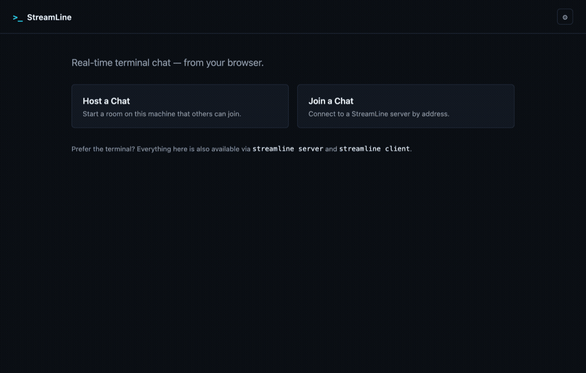

# StreamLine

Private, self-hosted chat - one app, a terminal or a browser, no account required.

[](https://github.com/L1avZh/StreamLine/actions/workflows/ci.yml)

## Demo

Same conversation, two front ends - a terminal client and a browser tab talking to the same room.

| CLI | Web |
| --- | --- |
|  |  |

## Why StreamLine?

Opening a private chat room shouldn't mean signing up for a service or setting up a server.
StreamLine is a single app you run yourself, on your own machine or a server you control, with an
optional password and TLS.

## Features

- Run `streamline` and pick an option from the menu. Nothing to configure first.
- Use it from the terminal or from a local web page. Both use the same chat code underneath, so
  they behave the same way.
- Your nickname, default interface and connection settings are saved for next time. You can
  change them from the CLI or the web page.
- The web interface only listens on this machine by default, and the app doesn't send data
  anywhere else.
- `streamline server` / `client` / `web` still work directly with all their flags, if you want
  to script it.

## How to open StreamLine

StreamLine isn't a website or a desktop icon - it's a program you start from a terminal. If
that's new to you, here's the whole process:

### Step 1: Get the code and install it

Open a terminal (**Terminal** on macOS, **Terminal** on Linux, **PowerShell** or **Command
Prompt** on Windows) and run:

```bash
git clone https://github.com/L1avZh/StreamLine.git
cd StreamLine
pip install .
```

This needs Python 3.11+ already on your computer (check with `python3 --version`). Don't have
Python, or don't want to install anything? Use the **standalone download** instead - see
[docs/installation.md](docs/installation.md) for the no-Python option and Homebrew.

> **Don't run `pip install streamline`** - that name on PyPI belongs to a different, unrelated
> project. Use the `git clone` steps above instead.

### Step 2: Run it

Same terminal, same folder:

```bash
streamline
```

You should see a boxed menu appear right there in the terminal:

```
╭─────────────── StreamLine ───────────────╮
│ Self-hosted chat, terminal or browser    │
│                                          │
│   1  Web Interface                       │
│   2  Command Line                        │
│   3  Settings                            │
│   4  Help                                │
│   5  Exit                                │
╰──────────────────────────────────────────╯
```

Type `1` and press Enter for the web interface (your browser opens automatically), or `2` for the
terminal-only version. First time only, it'll also ask for a nickname - see
[docs/getting-started.md](docs/getting-started.md) for what happens next.

If `streamline` isn't found after `pip install .`, your terminal's `PATH` doesn't include Python's
script folder - run `python3 -m streamline.cli` instead, which always works.

## Usage

### Web Interface

```bash
streamline web
```

Starts a local server, picks a free port automatically, opens your browser, and prints the URL.
Binds to `127.0.0.1` by default - see [Security](#security).

### CLI

```bash
streamline server --password secret                                 # host a chat
streamline client --nickname alice --host 127.0.0.1 --port 12345    # join one
```

Full reference: [docs/cli.md](docs/cli.md).

## Architecture

The CLI and the web interface are two thin front ends over the same core - connecting,
authenticating, and sending/receiving messages all live in one place, so neither interface can
drift out of sync with the other. Details: [docs/development.md](docs/development.md).

```
        streamline
      (single entry point)
             │
     choose CLI or Web
      ┌──────┴──────┐
  Terminal CLI   Web Interface
  (Rich + Click) (FastAPI, local-only)
      └──────┬──────┘
      Shared chat core
   (ChatServer / ChatSession)
```

## Security

- The web control panel binds to `127.0.0.1` unless you explicitly opt into `--host 0.0.0.0`.
- No password is required by default; anyone who can reach a hosted chat's port can join unless
  you set one.
- TLS is off by default - traffic (including the password) is plaintext until you enable it.
- Passwords are never stored or logged.

Details: [docs/security.md](docs/security.md).

## Development

```bash
pip install -e ".[dev]"
ruff check . && ruff format .   # lint + format
mypy                             # type check
pytest                           # test
```

See [CONTRIBUTING.md](CONTRIBUTING.md) and [docs/development.md](docs/development.md).

## License

MIT - see [LICENSE](LICENSE).
